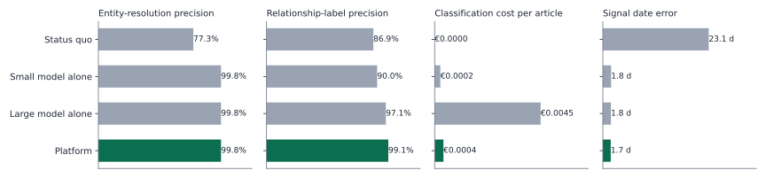
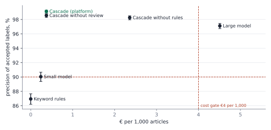
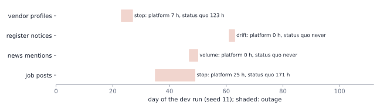
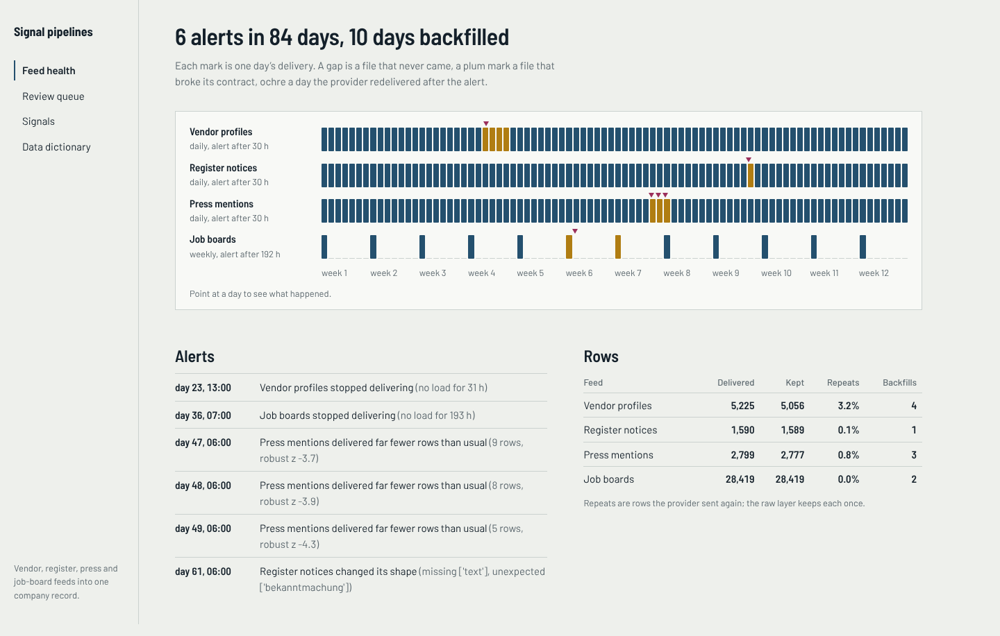
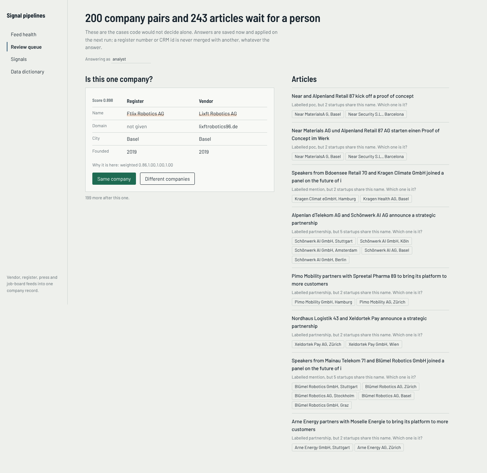

# company-signal-pipelines

Pipelines that turn messy company data into records a scouting product can trust. Four feeds come in: a data
vendor, German register notices, press articles and job boards. The pipelines then:

- **Load each delivery once**, check it, and raise an alert when a feed stops, thins out or changes shape. Missed
  days are backfilled when the feed returns.
- **Resolve the same company** across sources, even when the name has an umlaut, a legal form or a typo.
- **Classify how a corporate and a startup are related**, using rules, then a small model, then a large model, then a
  person, and record what each answer cost.
- **Date funding, acquisition, shutdown and hiring signals** by the earliest credible evidence, not by the day the
  data was loaded.
- **Keep acquired and closed startups out of recommendations.**

The stack is Postgres, dbt, Dagster, Hasura, FastAPI and Claude, with a React console for feed health and review.

It was built for the GlassDollar Senior Data Engineer application. It covers the same work as GlassDollar's
paid case day: classify corporate–startup relationships, remove duplicate companies, and report precision and cost
per record.

The sources are simulated, and the simulation keeps its own truth. So every number below is measured against what
was really true, not against what a pipeline believed. See [Limits](#limits).

## Results

<!-- results:start -->
Generated by `make report` from `reports/dev.json` (dev seeds 11, 12, 13, pooled; 95% intervals in brackets). The held-out world has not been run yet.

### Release gates (platform; rates judged on the worse end of the interval)

| gate | threshold | dev | held-out |
|---|---|---|---|
| er precision | ≥ 0.98 | 99.74% ✅ | not run |
| er recall | ≥ 0.85 | 98.56% ✅ | not run |
| relationship precision | ≥ 0.9 | 98.90% ✅ | not run |
| cost per record | ≤ 0.004 | €0.00037 ✅ | not run |
| outage detection | ≤ 36 | 25 h ✅ | not run |
| event date error | ≤ 7 | 1.7 d ✅ | not run |
| gone in recommendations | ≤ 0 | 0.0 ✅ | not run |



### Designs on the same luck (dev)

| design | ER precision | ER recall | label precision | € / 1k articles | signal date error | gone still recommended | worst outage detection |
|---|---|---|---|---|---|---|---|
| Status quo | 77.3% (76.5%–78.0%) | 63.3% (62.5%–64.0%) | 86.9% (86.2%–87.7%) | €0.00 | 23.1 d | 157.7 | never (drift unseen) |
| Small model alone | 99.8% (99.7%–99.9%) | 98.7% (98.6%–98.9%) | 90.0% (89.4%–90.7%) | €0.24 | 1.8 d | 0.3 | 25 h |
| Model alone | 99.8% (99.7%–99.9%) | 98.7% (98.6%–98.9%) | 97.1% (96.7%–97.5%) | €4.51 | 1.8 d | 0.0 | 25 h |
| Platform | 99.8% (99.7%–99.9%) | 98.7% (98.6%–98.9%) | 99.1% (98.9%–99.3%) | €0.37 | 1.7 d | 0.0 | 25 h |

The two model-alone designs change only the classification step; everything else is the platform.

### Ablations: the platform with one part removed (dev)

| removed | ER recall | label precision | € / 1k | signal precision | signal recall | date error | gone recommended |
|---|---|---|---|---|---|---|---|
| nothing (platform) | 98.7% (98.6%–98.9%) | 99.1% (98.9%–99.3%) | €0.37 | 96.3% (95.3%–97.2%) | 76.6% (74.6%–78.5%) | 1.7 d | 0.0 |
| without register name history | 97.9% (97.7%–98.1%) | 99.1% (98.9%–99.3%) | €0.37 | 95.9% (94.7%–96.8%) | 76.6% (74.6%–78.5%) | 1.7 d | 0.0 |
| without renormalised weights (a missing field scores zero) | 47.8% (47.0%–48.6%) | 99.1% (98.9%–99.3%) | €0.37 | 84.7% (82.9%–86.4%) | 76.6% (74.6%–78.5%) | 1.7 d | 2.3 |
| without umlaut transliteration | 92.8% (92.3%–93.2%) | 99.1% (98.9%–99.3%) | €0.37 | 94.5% (93.2%–95.5%) | 76.6% (74.6%–78.5%) | 1.7 d | 0.3 |
| with name-only fuzzy matching | 83.4% (82.7%–83.9%) | 99.1% (98.9%–99.3%) | €0.37 | 81.0% (78.9%–83.0%) | 62.3% (60.0%–64.5%) | 1.8 d | 1.0 |
| without the rule tier (every article starts at the small model) | 98.7% (98.6%–98.9%) | 98.3% (97.9%–98.5%) | €2.36 | 96.2% (95.0%–97.0%) | 76.6% (74.6%–78.5%) | 1.7 d | 0.0 |
| without the review queue (low-confidence labels accepted) | 98.7% (98.6%–98.9%) | 98.6% (98.3%–98.8%) | €0.37 | 95.9% (94.7%–96.8%) | 76.6% (74.6%–78.5%) | 1.8 d | 0.0 |
| without backfills | 98.7% (98.5%–98.9%) | 99.1% (98.9%–99.3%) | €0.37 | 96.7% (95.6%–97.5%) | 72.7% (70.7%–74.7%) | 3.0 d | 0.0 |
| dating events by ingestion | 98.7% (98.6%–98.9%) | 99.1% (98.9%–99.3%) | €0.37 | 96.3% (95.3%–97.2%) | 76.6% (74.6%–78.5%) | 19.4 d | 0.0 |
| without backfills, counting a missing week of job posts as zero | 98.7% (98.5%–98.9%) | 99.1% (98.9%–99.3%) | €0.37 | 21.2% (20.3%–22.2%) | 80.8% (78.9%–82.5%) | 4.7 d | 0.0 |
| without the jobs-feed shutdown signal | 98.7% (98.6%–98.9%) | 99.1% (98.9%–99.3%) | €0.37 | 96.4% (95.4%–97.3%) | 75.8% (73.7%–77.7%) | 2.6 d | 1.7 |



### Feed outages (dev seed 11)

| feed | kind | when | platform | status quo |
|---|---|---|---|---|
| vendor profiles | stop | day 23, 4 d | 7 h by freshness | 123 h (weekly look) |
| news mentions | volume | day 47, 3 d | 0 h by volume | never |
| register notices | drift | day 61, 2 d | 0 h by schema | never |
| job posts | stop | day 35, 14 d | 25 h by freshness | 171 h (weekly look) |

False alerts over three 84-day runs: 0. Rows kept after backfills: vendor profiles 100.0%, register notices 100.0%, news mentions 99.6%, job posts 100.0%. Duplicate raw rows: platform 0, status quo 170 per run.



### What each feed costs per correct datapoint (dev seed 11)

| feed | records billed | spend | companies | only in this feed | correct datapoints | € per correct datapoint |
|---|---|---|---|---|---|---|
| vendor profiles | 5,225 | €104.50 | 2,060 | 71 | 15,508 | €0.0067 |
| register notices | 1,590 | €6.36 | 1,483 | 0 | 5,854 | €0.0011 |
| news mentions | 2,799 | €2.80 | 0 | 0 | 2,220 | €0.0013 |
| job posts | 28,419 | €14.21 | 2,400 | 155 | 28,419 | €0.0005 |

### Company search (dev, 1800 queries written the way the press writes names)

| method | right company first | right company in top 5 |
|---|---|---|
| exact | 16.1% (14.5%–17.9%) | 19.0% (17.3%–20.9%) |
| normalised | 40.4% (38.2%–42.7%) | 51.1% (48.8%–53.4%) |
| fuzzy | 61.2% (58.9%–63.4%) | 82.1% (80.3%–83.8%) |

People in the loop per 84-day run: 217 doubtful company pairs, 16 relationship labels and 243 articles whose startup could be one of up to five companies. Golden-record field accuracy: name 94.3%, domain 100.0%, city 100.0%, country 100.0%, founded 100.0%, headcount 99.4%, status 99.9%.
<!-- results:end -->

## How it works

```
landing/<feed>/<day>.json ──► raw.record            idempotent: unique (feed, source key, payload hash)
 (vendor, register,           raw.load_run          every delivery, scheduled or backfill, loaded or quarantined
  press, job boards)          ops.alert             freshness · volume · contract · null rate · duplicates
                                   │
                                   ▼
                      source records (one per vendor id, register number, job domain, CRM row)
                                   │  block → score (renormalised weights) → merge ≥ 0.90 · queue 0.82–0.90
                                   │  identifiers decide: same domain merges, two register numbers never do
                                   ▼
                      core.entity ─── core.article: link (domain decides, names propose) + label
                                   │      rules → small model → large model → person
                                   ▼
                      core.event (earliest stated date, one per company/kind/window)
                      core.field_value (golden record with source, date and reason per field)
                                   │
                                   ▼  dbt build (staging views, marts, 25 tests)
                      analytics.companies · company_signals · relationships · recommendable_startups
                      analytics.feed_health · classification_cost
                                   │
                    ┌──────────────┼───────────────┐
                 Hasura (scout role, read-only)   FastAPI (search, review queues)   console (React)
```

Dagster runs this. `raw_feeds` is partitioned by day and keeps the monitors' state between runs. A sensor reacts to
a provider's redelivery file. A second job builds decisions and the dbt marts after each successful ingest (see
`src/signals/orchestration.py`).

The design choices are recorded as ADRs in [docs/adr](docs/adr):

- idempotent raw layer;
- identifiers decide;
- the classification cascade;
- evidence dates;
- golden-record provenance;
- the held-out world.

## Console

The console is a React app (Vite, Framer Motion). It has four views:

- **Feed health:** one mark per delivery, so you can see gaps and the backfills that patched them.
- **Review queue:** company pairs that only a person should decide, and articles whose relationship or startup a
  person should decide.
- **Signals:** each signal with the evidence behind it and how many days the market took to tell us.
- **Data dictionary:** the analytics columns with their descriptions from dbt.




## What the role asks for and where it is

| The posting asks for | Where it is here |
|---|---|
| Own ingestion from data vendors, scrapers and APIs | `src/signals/ingest`: idempotent loads, contracts, quarantine and backfills; the `raw_feeds` Dagster asset |
| Data quality, monitoring and alerting | monitors in `ingest/monitors.py`; `ops.alert`; dbt tests; Dagster asset check; hours-to-detect per outage |
| Entity resolution and deduplication | `src/signals/resolve`: blocking, weighted scoring, union–find with identifier guards, review queue |
| LLM classification at scale, precision and cost per record | `src/signals/classify`: cascade with prices in config; `classify/claude.py` for the real model |
| Postgres, dbt, Dagster, Hasura | `migrations/`, `dbt/`, `src/signals/orchestration.py`, `hasura/metadata.json` |
| Signals (funding, M&A, hiring) | `src/signals/events`: evidence with stated and seen dates; jobs-feed shutdown signal |
| Vendor evaluation | `evals/extras.py`: spend, coverage, companies only one feed has, € per correct datapoint |
| Search quality | `src/signals/search.py` and pg_trgm in the API; recall@1 and @5 benchmark |
| GDPR | `migrations/003_privacy.sql`: personal fields never leave raw, removed after 30 days; dbt test |

## Run it

```bash
make install            # Python deps + dbt in its own venv (dbt and Dagster pin different protobufs)
make test               # unit, pipeline and Postgres tests (Postgres tests skip without a database)
make eval               # every design on dev seeds 11, 12, 13 -> reports/dev.json
make report             # README results and docs/charts from the reports
make demo               # landing files -> Postgres raw/core -> dbt build (needs SIGNALS_DSN)
make api                # FastAPI on :8000;  cd web && npm run dev  for the console on :5173
docker compose up       # Postgres, Hasura, API and Dagster webserver together
```

`make heldout` runs the held-out world once and writes `reports/heldout.lock`. A second run refuses (see
[docs/heldout.md](docs/heldout.md)).

## Limits

- **The sources are simulated.** Real vendor files, Handelsregister notices and press text are messier. The world
  generates names with umlauts, legal forms, typos, rebrands and shared names, and four kinds of outage. Real
  feeds will produce failures it does not.
- **The models are simulated.** The small and large models are given accuracies (93%/70% and 98.5%/88% on
  clear/vague wording) and self-reported confidences. The real Claude classifier (`classify/claude.py`) follows the
  same protocol but was not run on these numbers. Prices per 1,000 tokens are in config and are assumptions. See
  [docs/assumptions.md](docs/assumptions.md).
- **The keyword rules were written against the dev world's phrasing.** That is why they look so good on dev. The
  held-out world uses 30% unseen phrasings to measure what happens when they stop matching.
- **Reviewers are assumed to be right.** The review queues report how many items a person handles, not how long
  that takes.
- **Some thresholds were tuned on dev seed 11:** the review band, the headcount trigger and the dark-weeks count.
  Each is noted where it is set in `config/pipelines.toml`.
- **Signals late in the window can lack evidence.** A vendor can take up to 45 days to show a round, so recall is
  bounded by what the market has published.

## Repository

```
config/        pipelines.toml (product), gates.toml, designs.toml; world.toml and heldout.toml (simulation only)
world/         the simulated market and its truth; nothing in src/ imports it
src/signals/   ingest, resolve, classify, events, golden, search, db, orchestration (Dagster), service (FastAPI)
evals/         adapter to the world, measurement, designs, vendor and search benchmarks, README generator
migrations/    plain numbered SQL
dbt/           staging views, marts, schema and singular tests
hasura/        metadata for the read-only scout role
web/           React console: feed health, review queue, signals, data dictionary
docs/          ADRs, assumptions, held-out protocol, charts, screenshots
```
